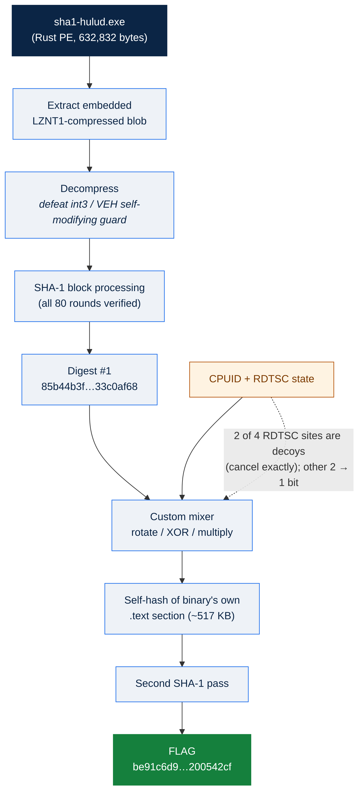
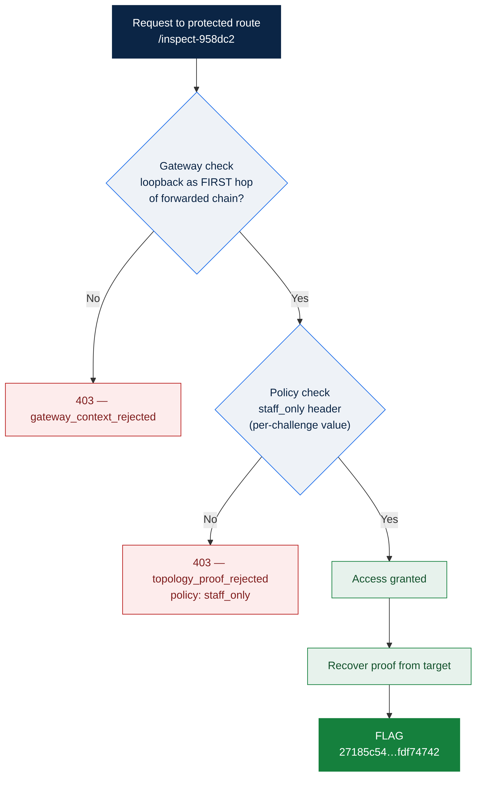

# Technical Write-up Collection
### Huntress CTF 2026: AI Arena
**Prepared by:** Dr. Jennifer Schieferle Uhlenbrock &nbsp;·&nbsp; **For:** Huntress CTF &nbsp;·&nbsp; **Team:** SU Pack &nbsp;·&nbsp; **Date:** October 31, 2026

---
This collection documents all **189 challenges / 561 flags** of the completed event. It opens with deep dives on the standout challenges (led by SHA1-Hulud, the event's hardest), followed by a complete week-by-week reference of every challenge: name, track, approach, and captured flag(s).

**Final result.** Team SU Pack completed 100% of the event at the maximum score of **1,885 points**, finishing **51st** on the live scoreboard. Many teams reached the same point ceiling; placement among them was decided by submission time.

**Flag provenance.** Every flag was recovered from the platform's authenticated record of accepted submissions for Team SU Pack; all read back as *correct*. Many flags are per-team dynamic values, so they are specific to this team's builds. Malware, script, and binary specimens were analyzed **statically only** — never executed.

> **A note on "key strategy steps."** For routine challenges, the approach line summarizes the analytical method the task exercises, drawn from the official brief — documentation of reasoning, not an operational exploit recipe. The deep dives add specifics for the challenges where the team's own solve trace is recorded. The two solution-flow diagrams are **reconstructions** from those notes, not captured screenshots.

## Part I — Deep dives: the standout challenges

### ★ SHA1-Hulud
**⚙️ Binary Reverse Engineering** · Day 30 · Nordgaren · _Hardest challenge of the event_

**Brief.** "I made this challenge because I was really upset that TeamPCP dropped the ball with this payload name. Anyway, here's Wonder Wall!" Each team received a unique build with its own flag, downloaded and submitted through the Game Master API.

**Artifact & setup.** Team-unique sha1_hulud.zip (password: infected) -> sha1-hulud.exe, 632,832 bytes, 64-bit Rust-compiled Windows PE with custom .xsobf string obfuscation and anti-analysis checks. Analyzed statically only (never executed).

**Key solution steps**

1. Phase 1 - Surface triage: enumerated the .xsobf string table (37 strings: registry paths + anti-debug/anti-VM tool names such as x64dbg.exe, ida64.exe, wireshark.exe), the single LZNT1-compressed blob (8,747 bytes), and three high-entropy regions. Ruled out PE overlay, .rsrc, and naive flag{ / huntress{ regex sweeps.
2. Phase 2 - Resolved the self-modifying obfuscation: the LZNT1 blob is decompressed and fed into standard SHA-1 block processing. The decompression routine is wrapped in exception-oriented-programming (an int3 trap caught by a Vectored Exception Handler). A key correction was made around the Microsoft x64 ABI (RDI/RSI are callee-saved, unlike SysV); re-tracing from the callee's own prologue resolved the handler as standard breakpoint-skip semantics. All 80 SHA-1 rounds recovered as legitimate; digest reproduced in pure Python as 85b44b3f15a5c43fadfd46713f57198533c0af68.
3. Phase 3 - Forward dataflow: the digest is never compared or printed directly. The packed H0||H1 qword feeds a custom rotate/XOR/multiply mixer, combined with CPUID-derived state in a second mixer, seeding a SECOND SHA-1 pass - a genuine multi-stage pipeline.
4. Breakthrough (run #3): of the four RDTSC sites initially flagged as an irreducible runtime-nondeterminism blocker, two were proven to be decoys that cancel exactly; the other two reduce to a single surviving bit b = (max_delta >= 0x200), injected via coefficient 0x4a8df669e8d834af into the mixer. The 'second SHA-1' input was identified as a ~517 KB self-hash of the binary's own mapped .text section (a code-integrity pattern), not a small fixed block as first assumed.
5. Resilience technique: because the analysis agent's own context kept compacting during the very long trace, a persistent progress.md checkpoint file was maintained in its workspace - every confirmed address/constant/formula recorded incrementally - so it always resumed from the last unresolved item rather than re-deriving from scratch.
6. Resolved to CORRECT, 5/5 points. The 64-hex-character flag shown here is the accepted submission recovered from the platform's own submission record.

**Solution flow (reconstructed)**

*Figure — Reconstructed solution flow for SHA1-Hulud. Illustration drawn from the team's analysis notes; **not** a capture of the original session (which expired after the Day 30–31 disconnect).*

> **Caveat.** Multiple earlier static-analysis sessions treated this as conclusively blocked by runtime nondeterminism before run #3 found the RDTSC decoy-cancellation and .text self-hash that made it tractable. A ~4-hour Chrome/Game Master disconnect during the final run means the exact submission sequence was not auditable from the chat UI; the flag was recovered from the platform submission record.

**Flag:** `be91c6d9c19b614a9ab3251189112da22cfc56ece161ce1890261762200542cf`

---

### Framework Roulette
**🌐 Web Exploitation** · Day 31 · John Hammond / Just Hacking Training · _Notable (most-contested web challenge)_

**Brief.** New stack, no map, no familiar names. Everything learned, none of the usual crutches - prove the skills travel. Played in-browser at the public arena or via the Game Master API; no Homebase/VPN required.

**Artifact & setup.** Live target behind a Cloudflare Worker fronting an ASP.NET Core Blazor Server backend.

**Key solution steps**

1. Mapped a two-stage access control on the protected route /inspect-958dc2 via distinct JSON error bodies.
2. Stage 1 (gateway trust) was fully solved and reproducible: the gateway accepts only when a loopback address is presented as the FIRST hop of the forwarded chain (leftmost-hop evaluation); other loopback/private representations and the RFC 7239 Forwarded header did not substitute.
3. Stage 2 (role/policy 'staff_only') was the long blocker: the 403's Vary header pointed at a custom per-challenge request header, but an exhaustive value sweep (role names, boolean forms, claim/JWT shapes, IDs, casing/underscore variants, long and encoded values) did not satisfy it during the documented runs - suggesting a derived/signed value rather than a guessable plaintext.
4. Resolved to CORRECT across all three modes. As with SHA1-Hulud, the exact final request was not auditable from the chat UI after a multi-hour disconnect; the flags shown are the accepted submissions from the platform record.

**Solution flow (reconstructed)**

*Figure — Reconstructed solution flow for Framework Roulette. Illustration drawn from the team's analysis notes; **not** a capture of the original session (which expired after the Day 30–31 disconnect).*

> **Caveat.** The documented runs solved the gateway stage conclusively and exhaustively characterized the policy stage, but the exact accepted value/mechanism for the staff_only policy header was not captured before a session expiry. Flags recovered from the platform submission record.

**Flags**

| Mode | Flag |
|---|---|
| Single Solve | `27185c545c70342c7e218d89fdf74742` |
| Time Trial | `173666fa4a23346d942374a3a7847930` |
| Mastery | `acc2ee1648fe3e20dbaee25d56f689ab` |

---

### Final Boss
**⚙️ Binary Reverse Engineering** · Day 31 · John Hammond / Just Hacking Training · _Capstone (Binary RE gauntlet)_

**Brief.** The gauntlet: everything learned across platforms and languages, in one campaign. Reconstruct it all, end to end, offline. No hints. (Archive password: infected.)

**Artifact & setup.** final_boss.zip

**Key solution steps**

1. The binary-RE capstone: a multi-binary campaign composing every toolchain/behavior family from the month's Binary RE track.
2. Reconstruct the loader/library/config graph fully offline via static disassembly.
3. Mastery (15 sets, 6,510 answer fields total) was already CORRECT server-side (accepted by teammate 'lordzero') when queried - no grind required.
4. All three modes Correct.

**Flags**

| Mode | Flag |
|---|---|
| Single Solve | `1b29d2f64ec6482a78f23a4887bf459c` |
| Time Trial | `a55bc33c2e99bd5aff94d9319081b854` |
| Mastery | `5a458152f9e238242678b9ed95517d5a` |

---

### The Full Transform
**📜 Script Analysis** · Day 31 · John Hammond / Just Hacking Training · _Capstone (Script Analysis gauntlet)_

**Brief.** An unseen XSLT-led campaign tying together all thirty-one languages, every hosted-source profile, and every finding family proven across the month. Read all of it, run none of it, deliver the final analysis. (Archive password: infected.)

**Artifact & setup.** the_full_transform.zip

**Key solution steps**

1. Treated as the month-long Script Analysis capstone: an XSLT transform orchestrating indicators across all 31 scripting languages seen earlier in the event.
2. Static reading only - classify each stage, normalize cross-language indicators to exact form, and assemble the campaign graph without executing the transform.
3. Mastery mode (15 sets, ~1,950 answer fields per set) was already marked CORRECT server-side via the shared team attempt when queried - reinforcing the lesson to always check attempt status before grinding a large bundle.
4. All three modes Correct.

**Flags**

| Mode | Flag |
|---|---|
| Single Solve | `8427b60ef255cc373c8901ce44ffefae` |
| Time Trial | `939d32a3400ab19b9e7f958f82a87e64` |
| Mastery | `01045ec3a90774211432e54662ad6e01` |

---

### Layered Protections
**📱 Mobile** · Day 30 · John Hammond / Just Hacking Training · _Notable (clean static solve of a 'heavy' mobile challenge)_

**Brief.** Unwind obfuscation, native indirection, runtime decryption, and integrity checks while proving the same backend effect.

**Artifact & setup.** layered_protections.apk (SHA-256 9fe0697...). Deliberately thinner than the prompt implies: 3 DEX classes, no native .so/JNI, no in-app crypto - the puzzle lives in a bundled asset the app code never reads.

**Key solution steps**

1. Found assets/huntress_puzzle.json: {schema: huntress.mobile.puzzle.v1, day:30, codec:'layered', data:'TU49OyInJlUlJSQkKilcKDFOUF4=', key:12}. The app's own code never references it - the asset IS the puzzle.
2. key:12 is NOT a fixed XOR byte; it is the starting value of an INCREMENTING per-byte key: plaintext[i] = base64_byte[i] XOR (12 + i), for i = 0..19.
3. That yields AC34264F102320F3-SNA; reversing the whole string (the brief's word 'Unwind') gives the answer ANS-3F023201F46243CA.
4. Time Trial used an obfuscated DEX release-code pipeline with signed/negative Dalvik constants (careful sign-handling required). Mastery's 14 sub-answers - including a native 'length-gated 64-bit mix', a secondary payload.dex load, and an Android feature-split half - all solved statically.
5. All three modes Correct. Lesson: when a single small integer is labeled 'key' next to longer ciphertext, try it as an incrementing per-byte key, and take prompt verbs like 'Unwind' literally.

**Flags**

| Mode | Flag |
|---|---|
| Single Solve | `d2432a7ec9b8f59654b4ec7f2f3beb2d` |
| Time Trial | `b62b524e47f181ae704bd4518f9f8bce` |
| Mastery | `268f929bd8eb13b964218a0f8bf50183` |

---

## Part II — Complete challenge reference (all 31 days)

Every challenge, grouped by week and day. Deep-dive challenges are marked ★ (see Part I). Flags are listed per mode: **S** = Single Solve, **T** = Time Trial, **M** = Mastery.

### Week 1 · Days 1–7

#### Day 1

| Challenge | Track | Approach | Flag(s) |
|---|---|---|---|
| **A Little Based** | 👶 Warmups | Identify the encoding/cipher from the clue, decode it with a standard tool (CyberChef / base/rot utilities), and submit the recovered plaintext; repeat on fresh Game Master targets for Time Trial and Mastery. | S: `96f4b3a2d17be15bd320894f53d19d4e` T: `fd5dd28d767efb156c124d774b40ed5a` M: `2173328d3d5b0cd3ec5e799fec7d7fd7` |
| **ELF Aware** | ⚙️ Binary Reverse Engineering | Inspect the binary statically (readelf/objdump/IDA/Ghidra) to recover headers, symbols, strings and control flow, identify the toolchain/behavior, and answer from the disassembly — no execution. | S: `665563705b7baaaff5210acb22cdf61f` T: `2d0ac71c8c1e2a1823b57bc264a49f57` M: `b04a1f29bc82ef6c40ecdea0303aeaec` |
| **Power Play** | 📜 Script Analysis | Read each specimen statically without running it, deobfuscate encodings and control flow, classify intent, map the primary MITRE ATT&CK technique, and extract the exact indicators. | S: `cb63e7df61bf35414a90d37b5564d9c8` T: `005455f8908f86716db88db52042b941` M: `612fcd6089bc5e8b45065e871cdf12ff` |
| **Exported Trust** | 📱 Mobile | Decompile the APK (jadx/apktool), review the manifest and DEX/native code for the relevant component, and recover the required evidence through static analysis. | S: `a404eca8a8e3c51a4fe8f7c3ca8b6d0b` T: `feea99e541ef1e2207db713dc0a91937` M: `1a15836fa8291edee0c24409eb2a0386` |
| **You Must Be This Hash to Ride** | 🔎 Metadata Forensics | Work from the bytes, not the labels: fingerprint each artifact by magic/structure/hashes, reconcile claimed vs. actual identity, and isolate the inconsistency. | S: `c65a1062cfc67db3bb0b990c7f4d1886` T: `9dbab5574323dcacec107786094634e2` M: `c8274fba84db8ae68ca34eeda6ed97ca` |
| **Welcome Robots** | 🤖 AI Native | Drive the AI Homebase Game Master agent end-to-end to locate the guide, start the task, and return the answer. | `bc14a99a263ad1df25aa2673ca541e1e` |
| **ℹ️ 📖 Read the Rules** | ℹ️ Information | Read the page and its source carefully for the planted flag. | `flag{bf61aced6e7f9335385a70f33b20d188}` |

#### Day 2

| Challenge | Track | Approach | Flag(s) |
|---|---|---|---|
| **Half a Turn** | 👶 Warmups | Identify the encoding/cipher from the clue, decode it with a standard tool (CyberChef / base/rot utilities), and submit the recovered plaintext; repeat on fresh Game Master targets for Time Trial and Mastery. | S: `b163db6fcd32e2f2369c9b83936eba71` T: `45cf2121c102b81674051e9ff6f96228` M: `29d1d65ddde529dccc8e895fb02061cc` |
| **Mangled** | ⚙️ Binary Reverse Engineering | Inspect the binary statically (readelf/objdump/IDA/Ghidra) to recover headers, symbols, strings and control flow, identify the toolchain/behavior, and answer from the disassembly — no execution. | S: `d6b37b2894d4a255eb006ea9fe52c2df` T: `a69e69a830e2a37a400b06e7d313b3fa` M: `fcb81fcbfc743f2d422877f9b3ec3bca` |
| **Host With the Most** | 📜 Script Analysis | Read each specimen statically without running it, deobfuscate encodings and control flow, classify intent, map the primary MITRE ATT&CK technique, and extract the exact indicators. | S: `3f49a713a6c706df9048e5413b327c19` T: `db595e043aa54a1a665a689088772d58` M: `1a617a9c06f2b015d5dbfca90e358ef4` |
| **Deep Link Drift** | 📱 Mobile | Decompile the APK (jadx/apktool), review the manifest and DEX/native code for the relevant component, and recover the required evidence through static analysis. | S: `0afd94abc8984041f5537d07cf678037` T: `8fd07be9cf03c67ca43071d6c875fed0` M: `75fa2d05ab670c576a1a14bb0c779806` |
| **Looks Can Be Deceiving** | 🔎 Metadata Forensics | Work from the bytes, not the labels: fingerprint each artifact by magic/structure/hashes, reconcile claimed vs. actual identity, and isolate the inconsistency. | S: `c503c52ddf67d5d2d3f0b0d06f1d4984` T: `c98ad96e95f6360b2c3345732b1e11ac` M: `e81007a5892ace50161fda1878a100de` |

#### Day 3

| Challenge | Track | Approach | Flag(s) |
|---|---|---|---|
| **Hex Appeal** | 👶 Warmups | Identify the encoding/cipher from the clue, decode it with a standard tool (CyberChef / base/rot utilities), and submit the recovered plaintext; repeat on fresh Game Master targets for Time Trial and Mastery. | S: `75c8454673c5877381c5f9fd785370e7` T: `9de010261bdc8cce1958c06aca301f9d` M: `0c44f2607887f0fd09b32d9a329dc62a` |
| **Table Manners** | ⚙️ Binary Reverse Engineering | Inspect the binary statically (readelf/objdump/IDA/Ghidra) to recover headers, symbols, strings and control flow, identify the toolchain/behavior, and answer from the disassembly — no execution. | S: `85b6b8acab1dd137970d34c9eb251586` T: `92e0c1db84a7b28d3acc48394381e48a` M: `0da65d1947fa3e2f82039ab696d5825a` |
| **Expansion Pack** | 📜 Script Analysis | Read each specimen statically without running it, deobfuscate encodings and control flow, classify intent, map the primary MITRE ATT&CK technique, and extract the exact indicators. | S: `739436ad92878ad782ac73eea5ad8ec6` T: `4e9d0eb690d98679a2fda8037e3de262` M: `9dd242a9924fba2ad72ca71979952be0` |
| **Intent Injection** | 📱 Mobile | Decompile the APK (jadx/apktool), review the manifest and DEX/native code for the relevant component, and recover the required evidence through static analysis. | S: `d5a372461168025a814ddec6b5ecbfcb` T: `f8f6f40504a679a29eade60cf6f20bcb` M: `404bf9f27d7adc87fdc3f70c21c5ad0e` |
| **BOM Voyage** | 🔎 Metadata Forensics | Work from the bytes, not the labels: fingerprint each artifact by magic/structure/hashes, reconcile claimed vs. actual identity, and isolate the inconsistency. | S: `eb955d5fdc900f22165bd586e69c4219` T: `d7e6efda37b2b2ef6798917e5dfa3b4e` M: `5459e2722068b6cf8235bf3229125bb8` |

#### Day 4

| Challenge | Track | Approach | Flag(s) |
|---|---|---|---|
| **Two of a Kind** | 👶 Warmups | Identify the encoding/cipher from the clue, decode it with a standard tool (CyberChef / base/rot utilities), and submit the recovered plaintext; repeat on fresh Game Master targets for Time Trial and Mastery. | S: `4a4021c302e395ba4b9b9977079d759e` T: `f3b5f491ced29b3f5e1e8e2543530eb0` M: `26d792ada8630fb17663cc559e2660fc` |
| **Go Fish** | ⚙️ Binary Reverse Engineering | Inspect the binary statically (readelf/objdump/IDA/Ghidra) to recover headers, symbols, strings and control flow, identify the toolchain/behavior, and answer from the disassembly — no execution. | S: `d7751e50a2ca4ef68467041ceb03d629` T: `db38fdc37f8bae4ad9a3ab1c2f8555f5` M: `a3e9d1b03aeffb179348dc64966cd0ac` |
| **Dim and Dimmer** | 📜 Script Analysis | Read each specimen statically without running it, deobfuscate encodings and control flow, classify intent, map the primary MITRE ATT&CK technique, and extract the exact indicators. | S: `4c13b12e4c7d5f09402b4ed5d901c4e3` T: `bd036f6b064cc907e005600ed45a831b` M: `8305100a7e089099a7d35514dd7ce228` |
| **Pending Intent Relay** | 📱 Mobile | Decompile the APK (jadx/apktool), review the manifest and DEX/native code for the relevant component, and recover the required evidence through static analysis. | S: `9c553857e2d830dc5115589f3c5ae9f7` T: `8f7e4ba91d0ba64c83c3188b120c6f25` M: `85c0b80be9ee6fa0fe783ee9910eb16b` |
| **Picture This** | 🔎 Metadata Forensics | Work from the bytes, not the labels: fingerprint each artifact by magic/structure/hashes, reconcile claimed vs. actual identity, and isolate the inconsistency. | S: `de97d9089f01ae6a68ad713d6c1e28d3` T: `2f5ae9064b2fcbd42ba305163c64d0b4` M: `58eaef8fb82d1835bc0f9f59bf0475ca` |

#### Day 5

| Challenge | Track | Approach | Flag(s) |
|---|---|---|---|
| **By the Numbers** | 👶 Warmups | Identify the encoding/cipher from the clue, decode it with a standard tool (CyberChef / base/rot utilities), and submit the recovered plaintext; repeat on fresh Game Master targets for Time Trial and Mastery. | S: `0247a53b952dd739266d94d4c840e924` T: `4a482e188d7b5721be4a65498f283318` M: `a87cd67c403540fdfaaf4423f0389414` |
| **Rust Belt** | ⚙️ Binary Reverse Engineering | Inspect the binary statically (readelf/objdump/IDA/Ghidra) to recover headers, symbols, strings and control flow, identify the toolchain/behavior, and answer from the disassembly — no execution. | S: `59008e68006fcfad0139bad42d9f1db0` T: `b025e969a475082f684825b0bc320eea` M: `e1184f9b0d82bbb233e50c643bde2d1f` |
| **Hatch Careful** | 📜 Script Analysis | Read each specimen statically without running it, deobfuscate encodings and control flow, classify intent, map the primary MITRE ATT&CK technique, and extract the exact indicators. | S: `3e75aa1343a24c97ff38c21040e96b6a` T: `fa3c7ff7a562f4bea267fe909ad258cc` M: `02843ff02bbf07f7ab99577ebe5cfb9f` |
| **Backup Spill** | 📱 Mobile | Decompile the APK (jadx/apktool), review the manifest and DEX/native code for the relevant component, and recover the required evidence through static analysis. | S: `16b256faa8a519028f0cd33a251aab16` T: `05e664f17fdea4fa49371d3de98e836f` M: `54ea9315aea094407d72eeaa5f324bb6` |
| **Chunk Norris** | 🔎 Metadata Forensics | Work from the bytes, not the labels: fingerprint each artifact by magic/structure/hashes, reconcile claimed vs. actual identity, and isolate the inconsistency. | S: `6c79f19ddaca4c9f7d122c054a9a69b6` T: `d1092a6aef124519f7a622d08bf8c143` M: `9068f20a5fbad21fc9a0518b024b0405` |

#### Day 6

| Challenge | Track | Approach | Flag(s) |
|---|---|---|---|
| **Eight Is Enough** | 👶 Warmups | Identify the encoding/cipher from the clue, decode it with a standard tool (CyberChef / base/rot utilities), and submit the recovered plaintext; repeat on fresh Game Master targets for Time Trial and Mastery. | S: `3fe5fc82477770296f3853dfe3e8aa89` T: `4946587d0840260185a0ff44f483efd8` M: `356cd23d83e3b7b2c48020ae1cd19aa9` |
| **Pool Party** | ⚙️ Binary Reverse Engineering | Inspect the binary statically (readelf/objdump/IDA/Ghidra) to recover headers, symbols, strings and control flow, identify the toolchain/behavior, and answer from the disassembly — no execution. | S: `9522c5dc6fab875d74b6bf6f1108e8bd` T: `3697d41df30e9221ec2d10c4374fc17a` M: `f6303e4ca29c441f6a579e4b8a1e71ee` |
| **Shell We Begin** | 📜 Script Analysis | Read each specimen statically without running it, deobfuscate encodings and control flow, classify intent, map the primary MITRE ATT&CK technique, and extract the exact indicators. | S: `5fa9ab682cede9c3b47617026fd274a4` T: `186566da871ca7768dda8231b559d2c0` M: `8af8230e3e94dc43269ae45d5b264b1a` |
| **Provider Paths** | 📱 Mobile | Decompile the APK (jadx/apktool), review the manifest and DEX/native code for the relevant component, and recover the required evidence through static analysis. | S: `76c07e1a86efb53a3484a3a05ba3e783` T: `509147c7cb10557a88ab99d7730dd3ad` M: `583797c9450bf25b1f45c7313ac49681` |
| **Portable Deception** | 🔎 Metadata Forensics | Work from the bytes, not the labels: fingerprint each artifact by magic/structure/hashes, reconcile claimed vs. actual identity, and isolate the inconsistency. | S: `f3802a11d238963ac696d8c4cbcbb4ce` T: `11aeaaa1e2c765892eea3aa7146162d7` M: `25b2e9cf0ff8bc8a869f7107ab52a221` |

#### Day 7

| Challenge | Track | Approach | Flag(s) |
|---|---|---|---|
| **Percent Chance** | 👶 Warmups | Identify the encoding/cipher from the clue, decode it with a standard tool (CyberChef / base/rot utilities), and submit the recovered plaintext; repeat on fresh Game Master targets for Time Trial and Mastery. | S: `2bb18cddeef8794224307b696f88326c` T: `847a47f5480c3217a4b88c6623d7f6b4` M: `ae170e0fb6fb0eb7961ec0f074394bb0` |
| **Routine Check** | ⚙️ Binary Reverse Engineering | Inspect the binary statically (readelf/objdump/IDA/Ghidra) to recover headers, symbols, strings and control flow, identify the toolchain/behavior, and answer from the disassembly — no execution. | S: `a33e014f138c3c53ada1b517ae70dacd` T: `602b91d37e9ef254e5e476a51de07117` M: `7c05c69de90297d60327708bcf986028` |
| **Node by Node** | 📜 Script Analysis | Read each specimen statically without running it, deobfuscate encodings and control flow, classify intent, map the primary MITRE ATT&CK technique, and extract the exact indicators. | S: `05943f29e247db48289b9bcaa0f8e13a` T: `17d1f712e440831a52b145af88b9cb1d` M: `20d63eb8431896b52cb8aaf13cda6775` |
| **WebView Bridge** | 📱 Mobile | Decompile the APK (jadx/apktool), review the manifest and DEX/native code for the relevant component, and recover the required evidence through static analysis. | S: `08cb7935caeabcb65cb2e5513fdff828` T: `ede12f726f0295ded86e43ce6d2d16a2` M: `080a08f4ac3ef67c5f4cb062d89d7455` |
| **Seven-Zip, No Relation** | 🔎 Metadata Forensics | Work from the bytes, not the labels: fingerprint each artifact by magic/structure/hashes, reconcile claimed vs. actual identity, and isolate the inconsistency. | S: `f04dfe90f3674bcf7cd0d581a23b8ade` T: `3dee0aee16ca8e6b8f6a18dd731d9ad6` M: `aeb31500eaf8a2f0cfa005eb2d5f80ce` |

### Week 2 · Days 8–14

#### Day 8

| Challenge | Track | Approach | Flag(s) |
|---|---|---|---|
| **Entity Relations** | 👶 Warmups | Identify the encoding/cipher from the clue, decode it with a standard tool (CyberChef / base/rot utilities), and submit the recovered plaintext; repeat on fresh Game Master targets for Time Trial and Mastery. | S: `c0b36e45f51b0bcc49e7098e2ec81e10` T: `b852946e7d72ae9277f1b4758fa570fe` M: `71fe10bc66bfa38d40ff7b802bd0a615` |
| **Swift Justice** | ⚙️ Binary Reverse Engineering | Inspect the binary statically (readelf/objdump/IDA/Ghidra) to recover headers, symbols, strings and control flow, identify the toolchain/behavior, and answer from the disassembly — no execution. | S: `258407b0d1a6112dec58892c5bbf31b2` T: `d5987a7e63b8144ce1e612267a6db69e` M: `1b1630ddaa7df0d4081dcbae3130d648` |
| **Lost in Translation** | 📜 Script Analysis | Read each specimen statically without running it, deobfuscate encodings and control flow, classify intent, map the primary MITRE ATT&CK technique, and extract the exact indicators. | S: `41212a290d9db270e92c41529ea98c9e` T: `eb6da2f4b2eb86373acc2455a291d505` M: `f32c9ade76b305a12ba82108e1e5664c` |
| **Cleartext Session** | 📱 Mobile | Decompile the APK (jadx/apktool), review the manifest and DEX/native code for the relevant component, and recover the required evidence through static analysis. | S: `1e20ca56bcbf1296b9b5904357768380` T: `65309bc5f3c0626d6daca7dc79aa8f88` M: `98503fbd5249d13d5fdc27c5da0e4a69` |
| **What’s in the Box?** | 🔎 Metadata Forensics | Work from the bytes, not the labels: fingerprint each artifact by magic/structure/hashes, reconcile claimed vs. actual identity, and isolate the inconsistency. | S: `a0a836e4daa7394d5ee6d5bfa4df9415` T: `e283b6d4fd20a258158b2052a2ec38e3` M: `91e5e54e6e30cfba5a5a02b0de902977` |

#### Day 9

| Challenge | Track | Approach | Flag(s) |
|---|---|---|---|
| **Escape Room** | 👶 Warmups | Identify the encoding/cipher from the clue, decode it with a standard tool (CyberChef / base/rot utilities), and submit the recovered plaintext; repeat on fresh Game Master targets for Time Trial and Mastery. | S: `e1f0fbd49f2c65b7e725d5c6dc6ce1d9` T: `349dbc4e618ab20582c76b946404be81` M: `12c1b091c4b69d90b923a7a672adf40e` |
| **Nimble** | ⚙️ Binary Reverse Engineering | Inspect the binary statically (readelf/objdump/IDA/Ghidra) to recover headers, symbols, strings and control flow, identify the toolchain/behavior, and answer from the disassembly — no execution. | S: `235c91d76350a9d6d68f32fcef68d5ca` T: `53e120c4a357aab0eda3bab56fe03ff7` M: `9a8ffbc2b0288a8a422fc3265b39b93e` |
| **All the World's a Stager** | 📜 Script Analysis | Read each specimen statically without running it, deobfuscate encodings and control flow, classify intent, map the primary MITRE ATT&CK technique, and extract the exact indicators. | S: `f5f560306549e1116c643c4b5e5009c0` T: `1b3f05a56eb01cfbb0d83d831c822999` M: `8976a5cdbf446070383225c693ecafd8` |
| **Trust Everyone** | 📱 Mobile | Decompile the APK (jadx/apktool), review the manifest and DEX/native code for the relevant component, and recover the required evidence through static analysis. | S: `a7abbb3c540a26bbde36ea3cd9e73215` T: `6cc95345baf2637767a02d23f861430d` M: `770646078d7263bf1cecfa409eb7767b` |
| **Built Different** | 🔎 Metadata Forensics | Work from the bytes, not the labels: fingerprint each artifact by magic/structure/hashes, reconcile claimed vs. actual identity, and isolate the inconsistency. | S: `cccdee2e5a720238c3422a4ec1efea63` T: `40126d33c472378723e5dd72b587dcec` M: `9de969a1b02dadd490c1761c5071dbd5` |

#### Day 10

| Challenge | Track | Approach | Flag(s) |
|---|---|---|---|
| **Thirty-Two Below** | 👶 Warmups | Identify the encoding/cipher from the clue, decode it with a standard tool (CyberChef / base/rot utilities), and submit the recovered plaintext; repeat on fresh Game Master targets for Time Trial and Mastery. | S: `3673ee4b819065f109fa6f274be36795` T: `e22f0bb817ed5c95af05bb4404737bb2` M: `4ba566290175e4833dc0b0c7cbb6aad2` |
| **Zig Zag** | ⚙️ Binary Reverse Engineering | Inspect the binary statically (readelf/objdump/IDA/Ghidra) to recover headers, symbols, strings and control flow, identify the toolchain/behavior, and answer from the disassembly — no execution. | S: `907fba9b2dcbbcd7fd60082e8c664c94` T: `f49697291493b95c5a2e5112397df022` M: `1de8865fc68baba09cfe9064e30b0838` |
| **Bind Over Matter** | 📜 Script Analysis | Read each specimen statically without running it, deobfuscate encodings and control flow, classify intent, map the primary MITRE ATT&CK technique, and extract the exact indicators. | S: `1abf1764fc6661c73103f68486626902` T: `97570ae1be4b2f3fe6700e2becd640bb` M: `4b5c6da7bffe156ba4865c116a56129a` |
| **Network Config Split** | 📱 Mobile | Decompile the APK (jadx/apktool), review the manifest and DEX/native code for the relevant component, and recover the required evidence through static analysis. | S: `2cf87d306fb31cf139f8d56f935e12b7` T: `4ec1dfb8dccaccf6a405ec15b6bcf52b` M: `4bc743cc28787d455f5500f5b608b06a` |
| **Where Do We Begin?** | 🔎 Metadata Forensics | Work from the bytes, not the labels: fingerprint each artifact by magic/structure/hashes, reconcile claimed vs. actual identity, and isolate the inconsistency. | S: `64872374eabbad5c0c1d0223b591b5ac` T: `f4031a46a6f95be06a18537c248224a4` M: `0f33d88d26ab766c1e7919872a425cda` |

#### Day 11

| Challenge | Track | Approach | Flag(s) |
|---|---|---|---|
| **Safe Travels** | 👶 Warmups | Identify the encoding/cipher from the clue, decode it with a standard tool (CyberChef / base/rot utilities), and submit the recovered plaintext; repeat on fresh Game Master targets for Time Trial and Mastery. | S: `658f49ec33bca9fb7b15151bed4f64ae` T: `78699cbb0888096fb9022c054b8baa6f` M: `d98b89d1d90ee320753e8c2f74c40460` |
| **D-Day** | ⚙️ Binary Reverse Engineering | Inspect the binary statically (readelf/objdump/IDA/Ghidra) to recover headers, symbols, strings and control flow, identify the toolchain/behavior, and answer from the disassembly — no execution. | S: `a3793c2087ea2c5800150e21f16c9751` T: `a7c20931cef60966c48320c87f4ec546` M: `639a2c4d1c0073ed64ac70c130b40e21` |
| **By Any Other Name** | 📜 Script Analysis | Read each specimen statically without running it, deobfuscate encodings and control flow, classify intent, map the primary MITRE ATT&CK technique, and extract the exact indicators. | S: `257577438e13cf809829c810933c2d6c` T: `5752228cb2f6f908ec06aa0b0f7a94b5` M: `907fe30730d92c76ae6cd07c04b42e38` |
| **Local Secrets** | 📱 Mobile | Decompile the APK (jadx/apktool), review the manifest and DEX/native code for the relevant component, and recover the required evidence through static analysis. | S: `99371fbb7d17725f741c56fe857bd9dc` T: `d0f10654544b5ad863f6884473d893c3` M: `87ef6e75ad36ce47fafe7c2dc293d965` |
| **What’s My Name Again?** | 🔎 Metadata Forensics | Work from the bytes, not the labels: fingerprint each artifact by magic/structure/hashes, reconcile claimed vs. actual identity, and isolate the inconsistency. | S: `0324efa7059f09ecf179e7ae68fd388b` T: `0b65e997e80b8577add57d63c4cf5679` M: `9fa9f03a3a24a09ba26f9d14cad706bd` |

#### Day 12

| Challenge | Track | Approach | Flag(s) |
|---|---|---|---|
| **Back at You** | 👶 Warmups | Identify the encoding/cipher from the clue, decode it with a standard tool (CyberChef / base/rot utilities), and submit the recovered plaintext; repeat on fresh Game Master targets for Time Trial and Mastery. | S: `ab2671ee688d160be599316157dabd1c` T: `d0ef218549801b23325dbad4828d730d` M: `a25bc95b726912bf4dee951be8246819` |
| **Pascal's Wager** | ⚙️ Binary Reverse Engineering | Inspect the binary statically (readelf/objdump/IDA/Ghidra) to recover headers, symbols, strings and control flow, identify the toolchain/behavior, and answer from the disassembly — no execution. | S: `a46d4b80cd5f602cd4e75d3f97978619` T: `604441bf95f5800deb1967378604324c` M: `e0cbd6b80d85a306feee660721b0c20a` |
| **AutoIt Takes Two** | 📜 Script Analysis | Read each specimen statically without running it, deobfuscate encodings and control flow, classify intent, map the primary MITRE ATT&CK technique, and extract the exact indicators. | S: `2241c8cff880f32a39d1069cd2c3f47c` T: `38e008338fddafb813d5cbc3c19a71a2` M: `aba4f6a1a0ce45738b24d5383724bf97` |
| **SQLite Assumptions** | 📱 Mobile | Decompile the APK (jadx/apktool), review the manifest and DEX/native code for the relevant component, and recover the required evidence through static analysis. | S: `5abe4441fb460101f962573f87401413` T: `56d41094cad9c59b646501d00c002ac3` M: `750e6bd599dede225b046feb01ecb336` |
| **Managed Expectations** | 🔎 Metadata Forensics | Work from the bytes, not the labels: fingerprint each artifact by magic/structure/hashes, reconcile claimed vs. actual identity, and isolate the inconsistency. | S: `7e4f73fae2af52b3a2f5fac637c03885` T: `833fcbdde47b7b3193a4741daff601e2` M: `3e636528b0d7face4af64aeaf44e6121` |

#### Day 13

| Challenge | Track | Approach | Flag(s) |
|---|---|---|---|
| **Opposite Day** | 👶 Warmups | Identify the encoding/cipher from the clue, decode it with a standard tool (CyberChef / base/rot utilities), and submit the recovered plaintext; repeat on fresh Game Master targets for Time Trial and Mastery. | S: `9c10cc28e81a7630aac6a20d26c3d0a3` T: `de4604ba58c8a37cd4ef4b98b4248b03` M: `2601d64253527e92c74be38024de9a86` |
| **Crystal Clear** | ⚙️ Binary Reverse Engineering | Inspect the binary statically (readelf/objdump/IDA/Ghidra) to recover headers, symbols, strings and control flow, identify the toolchain/behavior, and answer from the disassembly — no execution. | S: `9dcb5e44f53b2f035744c20057304623` T: `652c79976fd4a492938381723ae3fb3c` M: `9f410b17afa05058307626d5dab4fad7` |
| **Zip Code** | 📜 Script Analysis | Read each specimen statically without running it, deobfuscate encodings and control flow, classify intent, map the primary MITRE ATT&CK technique, and extract the exact indicators. | S: `1ff9c7f0f6cd365244b0c4f4538dbc4c` T: `c3683ebe02fed8a7a9b8ee3ba9822647` M: `30d957827ec08562d14dad98d9288be5` |
| **Keystore Misuse** | 📱 Mobile | Decompile the APK (jadx/apktool), review the manifest and DEX/native code for the relevant component, and recover the required evidence through static analysis. | S: `3b2d56218675d8ed318393df066b66ee` T: `5cfdc5e97f5682c99acc6d5aa7867b8e` M: `792a741b1ef143bd12c4138aef4a7545` |
| **Product Placement** | 🔎 Metadata Forensics | Work from the bytes, not the labels: fingerprint each artifact by magic/structure/hashes, reconcile claimed vs. actual identity, and isolate the inconsistency. | S: `0a2d81204f99f2228b919d43cc40de46` T: `766b9498d56ab29a478e131026ef3dc5` M: `23ec19c8ed595772a4537e812a09bd5f` |

#### Day 14

| Challenge | Track | Approach | Flag(s) |
|---|---|---|---|
| **Seven Steps** | 👶 Warmups | Identify the encoding/cipher from the clue, decode it with a standard tool (CyberChef / base/rot utilities), and submit the recovered plaintext; repeat on fresh Game Master targets for Time Trial and Mastery. | S: `24a045da2462193148d9c442dbd5619d` T: `3dd76002559ca9178d9f0b3ef6224272` M: `0396848ffac023b4753bacfbfeb8f414` |
| **Selective Memory** | ⚙️ Binary Reverse Engineering | Inspect the binary statically (readelf/objdump/IDA/Ghidra) to recover headers, symbols, strings and control flow, identify the toolchain/behavior, and answer from the disassembly — no execution. | S: `871527e93dc4a51fb604addad72d709b` T: `1339045e7dc25c4397c9073c5a03bd89` M: `8979b3fa53717072e33d019b967f2545` |
| **Trust the Process** | 📜 Script Analysis | Read each specimen statically without running it, deobfuscate encodings and control flow, classify intent, map the primary MITRE ATT&CK technique, and extract the exact indicators. | S: `d950b10c7906ec4f0b881685a467b93e` T: `f21d04d777539a281d75ff1b6666628b` M: `db052511e34f3243d01856e0491de4c3` |
| **Predictable Crypto** | 📱 Mobile | Decompile the APK (jadx/apktool), review the manifest and DEX/native code for the relevant component, and recover the required evidence through static analysis. | S: `96b7e4291bff71575458d9db055a23df` T: `c5df50a42699e0fe9a1b5f30ee11c1b5` M: `a151e6ed6d83abe07976540ec165996b` |
| **The Shortcut Home** | 🔎 Metadata Forensics | Work from the bytes, not the labels: fingerprint each artifact by magic/structure/hashes, reconcile claimed vs. actual identity, and isolate the inconsistency. | S: `aa7a5349f877c5bddbb2d389b5b79530` T: `47293225e2fd9837ebfb865cb409c1b2` M: `724d69721a56689f6d6400d3d768c12d` |

### Week 3 · Days 15–21

#### Day 15

| Challenge | Track | Approach | Flag(s) |
|---|---|---|---|
| **Room Forty-Seven** | 👶 Warmups | Identify the encoding/cipher from the clue, decode it with a standard tool (CyberChef / base/rot utilities), and submit the recovered plaintext; repeat on fresh Game Master targets for Time Trial and Mastery. | S: `e2ff36a9aca01f43b3744184a277b52b` T: `88b553a9b25e71c09f85d8d3f5367f3c` M: `b784ca0658293ff691f26611eb30ada4` |
| **Stripped** | ⚙️ Binary Reverse Engineering | Inspect the binary statically (readelf/objdump/IDA/Ghidra) to recover headers, symbols, strings and control flow, identify the toolchain/behavior, and answer from the disassembly — no execution. | S: `817d8923b32d5c5473adda2a26243432` T: `03b6b9fc8ccb6772fdf7e670083a0357` M: `45c5168887eb37e10599c855ba028be9` |
| **Crumb Trail** | 📜 Script Analysis | Read each specimen statically without running it, deobfuscate encodings and control flow, classify intent, map the primary MITRE ATT&CK technique, and extract the exact indicators. | S: `49541ff6f86f813d726dd8eecf481d9a` T: `4871aae326dd310d7f830b86ed7f98ad` M: `7355d240738c7e11648083a810a5799e` |
| **Native Library Secrets** | 📱 Mobile | Decompile the APK (jadx/apktool), review the manifest and DEX/native code for the relevant component, and recover the required evidence through static analysis. | S: `5d23aa7573575761d2ae425c740fe75c` T: `b94598a72095c7b42d9f2436fa04bc55` M: `714dbd1ffceb121f3cb57b7ef5caf91a` |
| **A Word to the Wise** | 🔎 Metadata Forensics | Work from the bytes, not the labels: fingerprint each artifact by magic/structure/hashes, reconcile claimed vs. actual identity, and isolate the inconsistency. | S: `1da70f8944abc40e7ba2d47aa1fe75a1` T: `a62a9d60cd7478a268e9f6401b545dd4` M: `27ca7c944c891fcca8f376a0c284e664` |

#### Day 16

| Challenge | Track | Approach | Flag(s) |
|---|---|---|---|
| **Dot Com** | 👶 Warmups | Identify the encoding/cipher from the clue, decode it with a standard tool (CyberChef / base/rot utilities), and submit the recovered plaintext; repeat on fresh Game Master targets for Time Trial and Mastery. | S: `d82c5dc135e9da5b247e8a1345fb36cd` T: `489f37422248fb69b41b1abff06abf45` M: `2bbf1298652477dbfe07444feebc7f7e` |
| **Wasm Up** | ⚙️ Binary Reverse Engineering | Inspect the binary statically (readelf/objdump/IDA/Ghidra) to recover headers, symbols, strings and control flow, identify the toolchain/behavior, and answer from the disassembly — no execution. | S: `731afb2b140f70557359caaabc6335b0` T: `b90af38c3ab20bec65ec6fd974f0b58c` M: `fb49b10fbe857b8aaacb4cac1d8a54ae` |
| **Same Same, But Different** | 📜 Script Analysis | Read each specimen statically without running it, deobfuscate encodings and control flow, classify intent, map the primary MITRE ATT&CK technique, and extract the exact indicators. | S: `612bc3615d3bb0e979ac6fb421871a9c` T: `8f3e3702b761914807941b53c8d13902` M: `066fa1204f79bd135db33604142b77cb` |
| **JNI Boundary** | 📱 Mobile | Decompile the APK (jadx/apktool), review the manifest and DEX/native code for the relevant component, and recover the required evidence through static analysis. | S: `772c0642cb0dafdb560bfb7fa542fb35` T: `5d3620ad1d85dc79f3b868a67843a4e4` M: `1d39782dfae33db95cbc0f77bf533642` |
| **Return to Sender** | 🔎 Metadata Forensics | Work from the bytes, not the labels: fingerprint each artifact by magic/structure/hashes, reconcile claimed vs. actual identity, and isolate the inconsistency. | S: `afe4aa7bad28f92f38eee713bb6d8f19` T: `ffe27a7ecd9506df0b07ac5b7086f613` M: `917425b2576c05b71d2dd92025e5933c` |

#### Day 17

| Challenge | Track | Approach | Flag(s) |
|---|---|---|---|
| **Bacon Bits** | 👶 Warmups | Identify the encoding/cipher from the clue, decode it with a standard tool (CyberChef / base/rot utilities), and submit the recovered plaintext; repeat on fresh Game Master targets for Time Trial and Mastery. | S: `99cb5b0c5444b28264b5e73ad555dc8a` T: `c057541481df13acb636478ec89fadd5` M: `946cc27781aeecc84463fd20198cebbf` |
| **Decoder Ring** | ⚙️ Binary Reverse Engineering | Inspect the binary statically (readelf/objdump/IDA/Ghidra) to recover headers, symbols, strings and control flow, identify the toolchain/behavior, and answer from the disassembly — no execution. | S: `2ee08b8984bb604bbee626e1164caa17` T: `39f176cb04f3a6d433edbebbfe23310a` M: `8bbb7fe37ebee7fdddd1ab04390d43a7` |
| **Fetch Quest** | 📜 Script Analysis | Read each specimen statically without running it, deobfuscate encodings and control flow, classify intent, map the primary MITRE ATT&CK technique, and extract the exact indicators. | S: `3bcfd60750bc6103ec58b8c70ae6e9d4` T: `502ea999059a3a00e43c72f4a6b28b5f` M: `370d531d5c1b719f19ed62981e566efc` |
| **Name Collapse** | 📱 Mobile | Decompile the APK (jadx/apktool), review the manifest and DEX/native code for the relevant component, and recover the required evidence through static analysis. | S: `34713cfd959c2678da1ecf66d59dabd9` T: `3a19b18ac6e77f5e4a53943271b80029` M: `988907dd07f98ac70198788b3293e029` |
| **Hear Me Out** | 🔎 Metadata Forensics | Work from the bytes, not the labels: fingerprint each artifact by magic/structure/hashes, reconcile claimed vs. actual identity, and isolate the inconsistency. | S: `d42e630a0f8a0af38d4fd26becb60149` T: `6a4d8f02764a4e6d5ae8d1ceefcaded7` M: `ce59e92f24b32f37e1914821f5091bf9` |

#### Day 18

| Challenge | Track | Approach | Flag(s) |
|---|---|---|---|
| **Off the Rails** | 👶 Warmups | Identify the encoding/cipher from the clue, decode it with a standard tool (CyberChef / base/rot utilities), and submit the recovered plaintext; repeat on fresh Game Master targets for Time Trial and Mastery. | S: `d1c139ea9387ab32fab81f4d26204b02` T: `793b73e732c2116cd07856a238b5c343` M: `4d8b9ef367c7071740b9000655d3402b` |
| **Flow State** | ⚙️ Binary Reverse Engineering | Inspect the binary statically (readelf/objdump/IDA/Ghidra) to recover headers, symbols, strings and control flow, identify the toolchain/behavior, and answer from the disassembly — no execution. | S: `fbd271352e4cbc09919b1c644855c93f` T: `7cff9f960c8f8de5862cc469f83d183d` M: `be93d25649d685362b93168dbcd9a415` |
| **Orphan Process** | 📜 Script Analysis | Read each specimen statically without running it, deobfuscate encodings and control flow, classify intent, map the primary MITRE ATT&CK technique, and extract the exact indicators. | S: `ddbb512bb004821944b577bf9db3517a` T: `cb0a677852b1881724cb8fbc4dc0aa3a` M: `09aaf1fde5322249f133b04705ab6663` |
| **Encrypted Strings** | 📱 Mobile | Decompile the APK (jadx/apktool), review the manifest and DEX/native code for the relevant component, and recover the required evidence through static analysis. | S: `0504c2e5a1f9d4414dbf313bb566f3f3` T: `39db3b269dc9373210bb55ac107b398c` M: `007130e8f899fa149269cb48db98b09e` |
| **Frame of Reference** | 🔎 Metadata Forensics | Work from the bytes, not the labels: fingerprint each artifact by magic/structure/hashes, reconcile claimed vs. actual identity, and isolate the inconsistency. | S: `dbddedfbc729f97d4e6e1426c120145f` T: `5a71fb061db5c63a89d7f34020b4fee4` M: `5d32fdff6272c2afeb8185b32250e47d` |

#### Day 19

| Challenge | Track | Approach | Flag(s) |
|---|---|---|---|
| **Little Things** | 👶 Warmups | Identify the encoding/cipher from the clue, decode it with a standard tool (CyberChef / base/rot utilities), and submit the recovered plaintext; repeat on fresh Game Master targets for Time Trial and Mastery. | S: `38deed914d2f54f66023a7bccb66a3bf` T: `d04d479a17a4adea2c75ba3c32020760` M: `13fb89898f0c60da9874215c2ebeb760` |
| **Jack in the Box** | ⚙️ Binary Reverse Engineering | Inspect the binary statically (readelf/objdump/IDA/Ghidra) to recover headers, symbols, strings and control flow, identify the toolchain/behavior, and answer from the disassembly — no execution. | S: `b6845f42e0118e05fde4611dfe8ef076` T: `3f4d0ff341277ff40cda8739b853f26d` M: `3d53a8995cf3878dbcedd2891e6c2c55` |
| **Sharp Practice** | 📜 Script Analysis | Read each specimen statically without running it, deobfuscate encodings and control flow, classify intent, map the primary MITRE ATT&CK technique, and extract the exact indicators. | S: `50f93452614ab8a31c6a6917c1ceea67` T: `d2f9e24a26f298acb5a16f866673ce7b` M: `af4df57fffee0c467c8306822c6bb85d` |
| **Reflection Maze** | 📱 Mobile | Decompile the APK (jadx/apktool), review the manifest and DEX/native code for the relevant component, and recover the required evidence through static analysis. | S: `e92cdf16c79482b74439a513b65aed12` T: `e7abef482c19ea15b19a5e357e45f79e` M: `eb53be4339515db66668cccdb23600d6` |
| **Back Up a Minute** | 🌐 Web Exploitation | Enumerate the application's routes and trust boundaries, identify the class of flaw named in the brief, and recover the proof the target gates behind it. | S: `e94c6e0909c7464a8c08b4df01a9bd4c` T: `faad696bb907dac055a8ab8265f3b7ee` M: `ba885db5019c6bc12c87d06189b44146` |
| **Permission to Slip** | 🌐 Web Exploitation | Enumerate the application's routes and trust boundaries, identify the class of flaw named in the brief, and recover the proof the target gates behind it. | S: `6ac4bf2199555914e6e5f272a754beb8` T: `db2e4ca54a38e186046dd7edd21d86bd` M: `5da667a252d836d8f747de3d83b0c816` |
| **Query Me This** | 🌐 Web Exploitation | Enumerate the application's routes and trust boundaries, identify the class of flaw named in the brief, and recover the proof the target gates behind it. | S: `dd867798d58e8d7187d1fe40a036e0cb` T: `904bd2e9ab970eb8a960bb8f897e5ab8` M: `e3fd4b8ceb0e64c391c777151dd88b43` |
| **Little Endian on the Prairie** | 🔎 Metadata Forensics | Work from the bytes, not the labels: fingerprint each artifact by magic/structure/hashes, reconcile claimed vs. actual identity, and isolate the inconsistency. | S: `957bd49845d0b452043c8436a48b819d` T: `be3d52d3099bf3697c9b4ceef745fa81` M: `e8ff0fdd079697228c494c1e5d4e4510` |

#### Day 20

| Challenge | Track | Approach | Flag(s) |
|---|---|---|---|
| **Big Entrance** | 👶 Warmups | Identify the encoding/cipher from the clue, decode it with a standard tool (CyberChef / base/rot utilities), and submit the recovered plaintext; repeat on fresh Game Master targets for Time Trial and Mastery. | S: `6063534fa46ddff36044ce7ae0f12489` T: `6bccab4aa85cba13b24bc0c1a5aa6220` M: `cd41bd541d1ccdd05abee491c79f4e1b` |
| **Resourceful** | ⚙️ Binary Reverse Engineering | Inspect the binary statically (readelf/objdump/IDA/Ghidra) to recover headers, symbols, strings and control flow, identify the toolchain/behavior, and answer from the disassembly — no execution. | S: `04af3852f575ce19d8db9df497a803ef` T: `1a4b205dcbaef856dee9e2b5ae90a464` M: `3d4acc70cec22974dea00d72074b11be` |
| **The Butler Did It** | 📜 Script Analysis | Read each specimen statically without running it, deobfuscate encodings and control flow, classify intent, map the primary MITRE ATT&CK technique, and extract the exact indicators. | S: `91522871b0971be1cb871c904c73259a` T: `6682ad3c23e67aeb4d2706e47777bddb` M: `32651938fe299b670903242433ea6400` |
| **Loaded Later** | 📱 Mobile | Decompile the APK (jadx/apktool), review the manifest and DEX/native code for the relevant component, and recover the required evidence through static analysis. | S: `b0c97cd6667d581b3ec6c9bc0945a6b3` T: `99412bbaec766c93f9914222f87570ab` M: `1410cd12ecd6f5c38f035fec84188b7f` |
| **Stay in Your Directory** | 🌐 Web Exploitation | Enumerate the application's routes and trust boundaries, identify the class of flaw named in the brief, and recover the proof the target gates behind it. | S: `fc2a37fb07643304dd1635f09866037c` T: `68cf543eb1db9a6253768144b762b535` M: `3f159a09910e2260c8322255fad2d84a` |
| **Administratively Speaking** | 🌐 Web Exploitation | Enumerate the application's routes and trust boundaries, identify the class of flaw named in the brief, and recover the proof the target gates behind it. | S: `300c554cff943adb9b5dfe50f1b156e0` T: `5694a4b1621c82a45ada60839bab76fa` M: `d0fcce9295fc8dd8fd2ecba73d4fb5fd` |
| **Universal Appeal** | 🔎 Metadata Forensics | Work from the bytes, not the labels: fingerprint each artifact by magic/structure/hashes, reconcile claimed vs. actual identity, and isolate the inconsistency. | S: `e130170ac5d45af8803ac0615d524bf9` T: `68bd43d9ab8035bac8c137bfed723001` M: `179d12e941368d238b4b78ddb2550c67` |

#### Day 21

| Challenge | Track | Approach | Flag(s) |
|---|---|---|---|
| **Under Pressure** | 👶 Warmups | Identify the encoding/cipher from the clue, decode it with a standard tool (CyberChef / base/rot utilities), and submit the recovered plaintext; repeat on fresh Game Master targets for Time Trial and Mastery. | S: `f68c149c19da13e36fe9b3d8dfb78e44` T: `1b7c82c799868164895e65ac892c44eb` M: `812fd077d051d400ac73f9c53dbd8139` |
| **Shared Custody** | ⚙️ Binary Reverse Engineering | Inspect the binary statically (readelf/objdump/IDA/Ghidra) to recover headers, symbols, strings and control flow, identify the toolchain/behavior, and answer from the disassembly — no execution. | S: `081df90f3f386d119728732c2d7df81b` T: `3b88e0802f3104f29b9848a3a9a78326` M: `30b02e476583fdcfa94e8aa74381e84a` |
| **Actions Speak Louder** | 📜 Script Analysis | Read each specimen statically without running it, deobfuscate encodings and control flow, classify intent, map the primary MITRE ATT&CK technique, and extract the exact indicators. | S: `03e02ce76b5cd21cf57f7c1e5509802a` T: `9df280f62f9124635ca1a6bf5f2923de` M: `a5a4102ec947361496ad0ce7083b9a61` |
| **Debug Me If You Can** | 📱 Mobile | Decompile the APK (jadx/apktool), review the manifest and DEX/native code for the relevant component, and recover the required evidence through static analysis. | S: `3954e018e5a1fa5ddb8f1b35de7fe997` T: `f35ac2ca138385c1eab8da3f7eb55f3d` M: `8e6157d35a2559a33a35fd2958e5aa8d` |
| **Reflect Upon This** | 🌐 Web Exploitation | Enumerate the application's routes and trust boundaries, identify the class of flaw named in the brief, and recover the proof the target gates behind it. | S: `f79b8aa661ccb77a084b0bedc3c16b92` T: `0733a3d2f5d9805a49c09685726ba566` M: `303bf5d1410e27b21b348c4599d5e83f` |
| **Stored for Later** | 🌐 Web Exploitation | Enumerate the application's routes and trust boundaries, identify the class of flaw named in the brief, and recover the proof the target gates behind it. | S: `602158f1d41ba7e441d778de7646d342` T: `69197db97208799badb7e5851c1509f5` M: `baa5d750aadef5719fe81063c87db1af` |
| **Session Impression** | 🌐 Web Exploitation | Enumerate the application's routes and trust boundaries, identify the class of flaw named in the brief, and recover the proof the target gates behind it. | S: `4918cc56d19c6a0dce40a0f0871e3d53` T: `fe2382523444bb74c1d2a34c3e595d5a` M: `e4c79a2d144fe7f206e569cfe7a72bc4` |
| **Package Deal** | 🔎 Metadata Forensics | Work from the bytes, not the labels: fingerprint each artifact by magic/structure/hashes, reconcile claimed vs. actual identity, and isolate the inconsistency. | S: `37734b7f55befc465efe72bff02a683d` T: `716d6e31ed6d9323ee577fe45db5930c` M: `af1a9308af4b90d7872c176b8e663228` |

### Week 4 · Days 22–28

#### Day 22

| Challenge | Track | Approach | Flag(s) |
|---|---|---|---|
| **Deflated Ego** | 👶 Warmups | Identify the encoding/cipher from the clue, decode it with a standard tool (CyberChef / base/rot utilities), and submit the recovered plaintext; repeat on fresh Game Master targets for Time Trial and Mastery. | S: `e60950ccfaf99bf7f983b07f67237d4d` T: `c1e50ae1cb3e6372309599c3f6c5304c` M: `44c9189b6f9c8409a7a7b7bca2451818` |
| **Bridge Troll** | ⚙️ Binary Reverse Engineering | Inspect the binary statically (readelf/objdump/IDA/Ghidra) to recover headers, symbols, strings and control flow, identify the toolchain/behavior, and answer from the disassembly — no execution. | S: `b5abfefdd6266fecbbf2ececa8504d6a` T: `a19ff2fdc212297f144413b69f1104af` M: `4bca9ef5b028e5aea521495e400e0f3b` |
| **Next, Next, Finish** | 📜 Script Analysis | Read each specimen statically without running it, deobfuscate encodings and control flow, classify intent, map the primary MITRE ATT&CK technique, and extract the exact indicators. | S: `26a7f56db8d1ed700824396f8f0d2351` T: `faade04b6c5b5d4f08176b4740186aac` M: `2604c4c53c681f96bcaceea2e7473c4d` |
| **Root of Trust** | 📱 Mobile | Decompile the APK (jadx/apktool), review the manifest and DEX/native code for the relevant component, and recover the required evidence through static analysis. | S: `88f65158dd45207817f5c9e719208a43` T: `e2952197ae72535be00497110f6d8f8c` M: `9eb8ee5ca369cd3e10fdfa633c4d0bfb` |
| **Forged With Care** | 🌐 Web Exploitation | Enumerate the application's routes and trust boundaries, identify the class of flaw named in the brief, and recover the proof the target gates behind it. | S: `1a6806e146d57d09f122bcc1c9ef0d3c` T: `cfdb1f55ca44399692fb53f2937fe7ee` M: `4234858d972584f9a8a984e2aa89a284` |
| **Uploading Expectations** | 🌐 Web Exploitation | Enumerate the application's routes and trust boundaries, identify the class of flaw named in the brief, and recover the proof the target gates behind it. | S: `268742fb9bc75158a70a4fc3595d4804` T: `3d8218af1ef2446b26c416efc053b91b` M: `2d5882110c426fd69f678835bf25d432` |
| **Main Character Energy** | 🔎 Metadata Forensics | Work from the bytes, not the labels: fingerprint each artifact by magic/structure/hashes, reconcile claimed vs. actual identity, and isolate the inconsistency. | S: `3cecd821f203020c150b0a62c1801e96` T: `4a5764702d8bb23d3f21ce66c50fe633` M: `3126d78bf9f0447f1113b9ec2df6dd8e` |

#### Day 23

| Challenge | Track | Approach | Flag(s) |
|---|---|---|---|
| **Eighty-Five Alive** | 👶 Warmups | Identify the encoding/cipher from the clue, decode it with a standard tool (CyberChef / base/rot utilities), and submit the recovered plaintext; repeat on fresh Game Master targets for Time Trial and Mastery. | S: `076732d687979969064847a6e7050fac` T: `f9972fe89641272d3c222914145df69f` M: `8e64a0facb1792e0a61ca1048095ec12` |
| **Trust Issues** | ⚙️ Binary Reverse Engineering | Inspect the binary statically (readelf/objdump/IDA/Ghidra) to recover headers, symbols, strings and control flow, identify the toolchain/behavior, and answer from the disassembly — no execution. | S: `e8b628b9aa605d1a922f8a717584ab74` T: `b1a195c18b2f8733eb0726dddc0e3811` M: `8218f948a70a2e2df61f70b05b18ad93` |
| **Press Start to Decode** | 📜 Script Analysis | Read each specimen statically without running it, deobfuscate encodings and control flow, classify intent, map the primary MITRE ATT&CK technique, and extract the exact indicators. | S: `be78edf2c8e172e7d13a45b17f8ddaf2` T: `b09755bee8d56f4c947de10fa3ad1a34` M: `7fac74f53a87415c0a40cbc0bb0b2da4` |
| **Hook Line and Signal** | 📱 Mobile | Decompile the APK (jadx/apktool), review the manifest and DEX/native code for the relevant component, and recover the required evidence through static analysis. | S: `6f391dba1c573db5fd313455b12ea0ec` T: `32ccc5f6fec92aefb0e0e53ef6427486` M: `eec2b92c769ca47c82986f6a2a5f3474` |
| **Template Temper** | 🌐 Web Exploitation | Enumerate the application's routes and trust boundaries, identify the class of flaw named in the brief, and recover the proof the target gates behind it. | S: `dfbfb9a1a7b076ab053be8997fd844de` T: `ab1670068be7500c650b715c6825f342` M: `07e5aa7eda29d6dd5a3c9e042ecfe157` |
| **Ask Again Later** | 🌐 Web Exploitation | Enumerate the application's routes and trust boundaries, identify the class of flaw named in the brief, and recover the proof the target gates behind it. | S: `03258510cc7b5c22167988697694f160` T: `1bfbe7f079258d91e82ae0d7a68e2d22` M: `2925c8f5982abd35e44a43671c1f62d6` |
| **Posted Too Much** | 🌐 Web Exploitation | Enumerate the application's routes and trust boundaries, identify the class of flaw named in the brief, and recover the proof the target gates behind it. | S: `57802884fbcf2a89e42f6148d4c83c32` T: `66a163086350cb16e8d5ae9d2d7c1a48` M: `00fe4ea21f8daf18f47700dc1ddf57fc` |
| **Page Me Maybe** | 🔎 Metadata Forensics | Work from the bytes, not the labels: fingerprint each artifact by magic/structure/hashes, reconcile claimed vs. actual identity, and isolate the inconsistency. | S: `b81024769517652bff448b9d35a764f6` T: `4758df33b7136c69c53aa5dbd00e4c9e` M: `679963e3abe6a07b71cae58292c267b7` |

#### Day 24

| Challenge | Track | Approach | Flag(s) |
|---|---|---|---|
| **String Theory** | 👶 Warmups | Identify the encoding/cipher from the clue, decode it with a standard tool (CyberChef / base/rot utilities), and submit the recovered plaintext; repeat on fresh Game Master targets for Time Trial and Mastery. | S: `e43af903dfb65e7429e13126a8631444` T: `42bebb6ba69b51c9789da36e1ab29000` M: `f69c8d03298abead6778daeea9d8ae34` |
| **Spot the Difference** | ⚙️ Binary Reverse Engineering | Inspect the binary statically (readelf/objdump/IDA/Ghidra) to recover headers, symbols, strings and control flow, identify the toolchain/behavior, and answer from the disassembly — no execution. | S: `96a0fc59f6ad6d61ba39ef1d78c23fdb` T: `0e5dace68d8b079b11125cf0c0d4b6b2` M: `90eeeefd4541b960ab25000f56a34fc3` |
| **Web of Lies** | 📜 Script Analysis | Read each specimen statically without running it, deobfuscate encodings and control flow, classify intent, map the primary MITRE ATT&CK technique, and extract the exact indicators. | S: `fbf8809f0d88d41bd9d297a17f6287c2` T: `6a90920234a3c75bbaf9808c830174b6` M: `457e013e8a117e4a7c6fef259251f173` |
| **Emulator Alibi** | 📱 Mobile | Decompile the APK (jadx/apktool), review the manifest and DEX/native code for the relevant component, and recover the required evidence through static analysis. | S: `bffcc20815a1965d2ee005cbf875cbca` T: `b0ed4ae2e176c839723a567a2f56dd3f` M: `5911e69118ba8f96997f1154890e59e1` |
| **The API Has Opinions** | 🌐 Web Exploitation | Enumerate the application's routes and trust boundaries, identify the class of flaw named in the brief, and recover the proof the target gates behind it. | S: `5d654ab71f0a4a225c908f611b87f905` T: `57a64b4da6d9ecdb6f90513ab3d621db` M: `72d856af9beb08864f03c8117cf25641` |
| **Fetch Quest** | 🌐 Web Exploitation | Enumerate the application's routes and trust boundaries, identify the class of flaw named in the brief, and recover the proof the target gates behind it. | S: `0d592ffe656f27144c134ad9613f5606` T: `9bbaf3b945b39e71ba1d40b50dcb6e03` M: `b267c0c46621ee16925495b5c2c03159` |
| **Event Horizon** | 🔎 Metadata Forensics | Work from the bytes, not the labels: fingerprint each artifact by magic/structure/hashes, reconcile claimed vs. actual identity, and isolate the inconsistency. | S: `c24129e7a939ab6a1c3c7af440c33222` T: `41c0c6670c5b2dd3c8dbb7ea646b5563` M: `823d92d91ca2b18328661667fafbdb45` |

#### Day 25

| Challenge | Track | Approach | Flag(s) |
|---|---|---|---|
| **You Have a Point** | 👶 Warmups | Identify the encoding/cipher from the clue, decode it with a standard tool (CyberChef / base/rot utilities), and submit the recovered plaintext; repeat on fresh Game Master targets for Time Trial and Mastery. | S: `f0d2ca81e38aa29261652b709c40e63c` T: `e88a10f78e3d0c309b4787b7af18b44c` M: `b5c9cb3ecd650fdaa0a978ff3abe3bc3` |
| **Out of Bounds** | ⚙️ Binary Reverse Engineering | Inspect the binary statically (readelf/objdump/IDA/Ghidra) to recover headers, symbols, strings and control flow, identify the toolchain/behavior, and answer from the disassembly — no execution. | S: `6b8a66be277f749ad835f0e6e172502d` T: `2b72fb18b4311741cc81db22e1c18a7e` M: `bf52e253eee3484d4c0235438a7accfb` |
| **Ashes to Assets** | 📜 Script Analysis | Read each specimen statically without running it, deobfuscate encodings and control flow, classify intent, map the primary MITRE ATT&CK technique, and extract the exact indicators. | S: `1fa22425d40bd710f47e7b24eb5005b5` T: `8a3ee808ab59ca4fa655d147e850732a` M: `b4cda9078e4dd5bba4201e0f5ba19605` |
| **Integrity Signals** | 📱 Mobile | Decompile the APK (jadx/apktool), review the manifest and DEX/native code for the relevant component, and recover the required evidence through static analysis. | S: `6268d57cda01b786c9d0b34282c48b39` T: `fac12b6da6684a57c7aef19d613e174e` M: `eeeb2c3f779cd87a691a48dbbac4a2c7` |
| **Shell Company** | 🌐 Web Exploitation | Enumerate the application's routes and trust boundaries, identify the class of flaw named in the brief, and recover the proof the target gates behind it. | S: `e8051c3ea5ae9b971c60eb575577384d` T: `be7d8b69d57a9fb8d34cf8cd2442a70c` M: `1b253f7a2e12283a9964d44e0dd7ec84` |
| **Reset Expectations** | 🌐 Web Exploitation | Enumerate the application's routes and trust boundaries, identify the class of flaw named in the brief, and recover the proof the target gates behind it. | S: `6bf32ceeba3eb147b00bcd832bb294ec` T: `45e261c25e51b0371f31ab12a6ac2631` M: `ab9cb7f47c911be096896c6f9dabc0e5` |
| **Resolver Revolt** | 🌐 Web Exploitation | Enumerate the application's routes and trust boundaries, identify the class of flaw named in the brief, and recover the proof the target gates behind it. | S: `f3e61b7bfe8a2ed1b9d7a9ddb62e3357` T: `396964b5af16eb498aa0ea0d5e7580c5` M: `41f6fb4c140829c63956107db9387ce8` |
| **Hive Mind** | 🔎 Metadata Forensics | Work from the bytes, not the labels: fingerprint each artifact by magic/structure/hashes, reconcile claimed vs. actual identity, and isolate the inconsistency. | S: `41bf48ef17e8871190090de934654dc4` T: `87b0116831e7d6dea0087979c83006c0` M: `5117fd0bede0b177710ca0c2e366a952` |

#### Day 26

| Challenge | Track | Approach | Flag(s) |
|---|---|---|---|
| **Food for Thought** | 👶 Warmups | Identify the encoding/cipher from the clue, decode it with a standard tool (CyberChef / base/rot utilities), and submit the recovered plaintext; repeat on fresh Game Master targets for Time Trial and Mastery. | S: `05243bf997c1b9fb2b166f1220e1ebb0` T: `9c0b372161c10fd406a7b6f6e0144dba` M: `ac3d8f297332d9573bc8e6123d317a23` |
| **Crash Course** | ⚙️ Binary Reverse Engineering | Inspect the binary statically (readelf/objdump/IDA/Ghidra) to recover headers, symbols, strings and control flow, identify the toolchain/behavior, and answer from the disassembly — no execution. | S: `7ab0f21b0b7cebf79b57a26546aaad19` T: `916bc8103b41fdcf83f03b83c470ca03` M: `f5216c7b832eac52a385867e7d765284` |
| **Mixed Signals** | 📜 Script Analysis | Read each specimen statically without running it, deobfuscate encodings and control flow, classify intent, map the primary MITRE ATT&CK technique, and extract the exact indicators. | S: `12382d4c770a69ec453b3f9c97289e05` T: `a84fac8b4fa0a470bdf4c286e233cba8` M: `16eeb9c82398015cc3b87c9ca38c37c6` |
| **Split Decision** | 📱 Mobile | Decompile the APK (jadx/apktool), review the manifest and DEX/native code for the relevant component, and recover the required evidence through static analysis. | S: `5cc0c0b89cfc65f2573183c12050f0d8` T: `d8339b55abacf0cb6175b5929591fc17` M: `d14ada26afa18fda0f8591c9d7161b50` |
| **Trust the Webhook** | 🌐 Web Exploitation | Enumerate the application's routes and trust boundaries, identify the class of flaw named in the brief, and recover the proof the target gates behind it. | S: `5f3b268ef6720de326a5a7a5deca2e4a` T: `c9efee49d4df090bff9adb582de4c208` M: `3088678f0234f12c62f824f9efc5f25d` |
| **Serialized Offender** | 🌐 Web Exploitation | Enumerate the application's routes and trust boundaries, identify the class of flaw named in the brief, and recover the proof the target gates behind it. | S: `ca987e09b27ca4911c721ad9aef9e4b8` T: `b98f90356d147782098c7674e0f36602` M: `ef17a1aa1451af64b49457f095796966` |
| **Before You Go** | 🔎 Metadata Forensics | Work from the bytes, not the labels: fingerprint each artifact by magic/structure/hashes, reconcile claimed vs. actual identity, and isolate the inconsistency. | S: `41acc976908fc4463b4c24ad186e9eab` T: `c4035b83c6333e8f30db4a165e5b54a3` M: `74df431a9d8653cb1354043afcff61ae` |

#### Day 27

| Challenge | Track | Approach | Flag(s) |
|---|---|---|---|
| **Monkey Business** | 👶 Warmups | Identify the encoding/cipher from the clue, decode it with a standard tool (CyberChef / base/rot utilities), and submit the recovered plaintext; repeat on fresh Game Master targets for Time Trial and Mastery. | S: `684bf48733221e3f39e12af92aff026e` T: `afaa48e5630db1dc6a0061c6238608e9` M: `d2aaa40b36ca335380abebf238daf32a` |
| **Compiler Says What** | ⚙️ Binary Reverse Engineering | Inspect the binary statically (readelf/objdump/IDA/Ghidra) to recover headers, symbols, strings and control flow, identify the toolchain/behavior, and answer from the disassembly — no execution. | S: `329fad1ae928354c57062b0a61cb17f8` T: `8ff2f3b468fd0f8930b3480396900aa6` M: `85b421fa5d8db964a9b0164aa408fb94` |
| **FROM Whence It Came** | 📜 Script Analysis | Read each specimen statically without running it, deobfuscate encodings and control flow, classify intent, map the primary MITRE ATT&CK technique, and extract the exact indicators. | S: `3dd5c96dcbc52d91b3d438dc319c3b69` T: `e7672696c192db86fc229b371c82d532` M: `79b92dbe069c187ca7a1ad4cc64c0238` |
| **Dependency Surface** | 📱 Mobile | Decompile the APK (jadx/apktool), review the manifest and DEX/native code for the relevant component, and recover the required evidence through static analysis. | S: `30cc1e1a0807698a080f871b606e6ded` T: `8b554e253496a113565be29e8e7e9927` M: `01c738bd0bf7f49317900a5d64901b51` |
| **Double Spent** | 🌐 Web Exploitation | Enumerate the application's routes and trust boundaries, identify the class of flaw named in the brief, and recover the proof the target gates behind it. | S: `2e428c9c8d404a94bde1ce4afa10b0fb` T: `7cd16e06d847d2889ef543d7307f9bdd` M: `1bb195fc440ccecfdcb0f4fe8b3a3118` |
| **Socket to Me** | 🌐 Web Exploitation | Enumerate the application's routes and trust boundaries, identify the class of flaw named in the brief, and recover the proof the target gates behind it. | S: `1d776769bf1185035fe2ec24de64a26c` T: `b4298df052d110aafefd498924ec4693` M: `2a2b9fce00bc81f92398e85bd61eb9a9` |
| **Forwarded Misgivings** | 🌐 Web Exploitation | Enumerate the application's routes and trust boundaries, identify the class of flaw named in the brief, and recover the proof the target gates behind it. | S: `215e4f9034929929c3a7cccdefd4275a` T: `6de8fd69bce1fbad4c0d703660556177` M: `6f7b6a4c2f632a10c3005e9939f3a5f4` |
| **Packet Loss Prevention** | 🔎 Metadata Forensics | Work from the bytes, not the labels: fingerprint each artifact by magic/structure/hashes, reconcile claimed vs. actual identity, and isolate the inconsistency. | S: `53f3a510706372826b83646cd938586e` T: `2c9da2fe37fea52de53fe874457ed1fb` M: `6c7d2311f91a4903fb15c1c168526184` |

#### Day 28

| Challenge | Track | Approach | Flag(s) |
|---|---|---|---|
| **Back in Sixteen** | 👶 Warmups | Identify the encoding/cipher from the clue, decode it with a standard tool (CyberChef / base/rot utilities), and submit the recovered plaintext; repeat on fresh Game Master targets for Time Trial and Mastery. | S: `975dd4b0f786ba93bea92bd7a779905a` T: `efff13edff1b4b646af9cd39b2a0b673` M: `dfefc74ceab8a0e99260980363dc461d` |
| **Family Resemblance** | ⚙️ Binary Reverse Engineering | Inspect the binary statically (readelf/objdump/IDA/Ghidra) to recover headers, symbols, strings and control flow, identify the toolchain/behavior, and answer from the disassembly — no execution. | S: `178e5686be93c6bd74a57a7e141d7622` T: `e436e33c6650a280c174c92744784f2d` M: `4220d3731631dd04be26729ca27915b6` |
| **Out of Order** | 📜 Script Analysis | Read each specimen statically without running it, deobfuscate encodings and control flow, classify intent, map the primary MITRE ATT&CK technique, and extract the exact indicators. | S: `3c545fb41ba307750c286573368a7dc7` T: `34fe7720df8fb4390b50db2cfe980b07` M: `d13a21977ea5c15b100252f0915da8cb` |
| **Protocol Reconstruction** | 📱 Mobile | Decompile the APK (jadx/apktool), review the manifest and DEX/native code for the relevant component, and recover the required evidence through static analysis. | S: `ff3201c80eb965200b4b4362b76313cc` T: `f3d75f8c1668af6d08acfc5cc46eef43` M: `43e1eb2d0bb1ecb96818b9a234a311e5` |
| **Fail Open Friday** | 🌐 Web Exploitation | Enumerate the application's routes and trust boundaries, identify the class of flaw named in the brief, and recover the proof the target gates behind it. | S: `3cee673948cac087433787819107c82c` T: `56d760a3a0f92bc456ad9d8aa174b3b5` M: `c00f41dd8051ec5498779788a8ec8977` |
| **If a Breach Falls in a Log** | 🌐 Web Exploitation | Enumerate the application's routes and trust boundaries, identify the class of flaw named in the brief, and recover the proof the target gates behind it. | S: `17e189b1947c49a76ed1d49f5fff71d3` T: `9aebf2ddaa57cc7d514a15d8bfff8a32` M: `aa99a71adfe9da57fb94fc0a3cade777` |
| **Where It All Began** | 🔎 Metadata Forensics | Work from the bytes, not the labels: fingerprint each artifact by magic/structure/hashes, reconcile claimed vs. actual identity, and isolate the inconsistency. | S: `63173c4646fc77af89654f7fb654a3b9` T: `097df99239b1fe375f81c267de617b5b` M: `c6a6f1558be9c429035fdd2cf99b1f71` |

### Week 5 · Days 29–31

#### Day 29

| Challenge | Track | Approach | Flag(s) |
|---|---|---|---|
| **Rotten Base** | 👶 Warmups | Identify the encoding/cipher from the clue, decode it with a standard tool (CyberChef / base/rot utilities), and submit the recovered plaintext; repeat on fresh Game Master targets for Time Trial and Mastery. | S: `f15360cb58c85f4d4f09379d0801a359` T: `e3e0fcdbbcd463b1155aa71276364e7a` M: `931db3f10c845ca750858e9ff9737f0e` |
| **Fraternal Twins** | ⚙️ Binary Reverse Engineering | Inspect the binary statically (readelf/objdump/IDA/Ghidra) to recover headers, symbols, strings and control flow, identify the toolchain/behavior, and answer from the disassembly — no execution. | S: `dd0f516d4ca348050e4ebea639c21629` T: `c39cc7ea20debc3c05709f4e2b3f1ea4` M: `76fa41b50812d063602c18e4e1e99932` |
| **Make It Make Sense** | 📜 Script Analysis | Read each specimen statically without running it, deobfuscate encodings and control flow, classify intent, map the primary MITRE ATT&CK technique, and extract the exact indicators. | S: `8cea407ba1024d7aadd8397d0c8aba36` T: `2830b315158f6d1d66d87af5e1620f54` M: `1a87412ddbaf2290dfc92625436d5758` |
| **White Box Key Recovery** | 📱 Mobile | Decompile the APK (jadx/apktool), review the manifest and DEX/native code for the relevant component, and recover the required evidence through static analysis. | S: `f3fe41473c8b08d8603b0102c70c76a3` T: `37202404519f3845cb6802e96eb51adc` M: `c6ed5a4ca89570178e9a37bd6ef6d9c0` |
| **Trust the Build** | 🌐 Web Exploitation | Enumerate the application's routes and trust boundaries, identify the class of flaw named in the brief, and recover the proof the target gates behind it. | S: `2361bbfbb0062500e73c5a37aeced346` T: `871a1ae0318160501c2ad15eb3eb51d1` M: `cb62de836305ee2e3cd81756c39aeed8` |
| **Internal Affairs** | 🌐 Web Exploitation | Enumerate the application's routes and trust boundaries, identify the class of flaw named in the brief, and recover the proof the target gates behind it. | S: `72468c3659705e64a2614cbc3554c7be` T: `bf84804b3f6b0fd84e32a7a6771aedc3` M: `8491793293daa33d54147e28c38d986b` |
| **Trust Issues** | 🔎 Metadata Forensics | Work from the bytes, not the labels: fingerprint each artifact by magic/structure/hashes, reconcile claimed vs. actual identity, and isolate the inconsistency. | S: `e803ecd212eccc7176552b20583258c1` T: `b234cc132679874c7e46d78a4b55249d` M: `a432e6baa00139f1a3ce1c69b441c3d4` |

#### Day 30

| Challenge | Track | Approach | Flag(s) |
|---|---|---|---|
| **Percent Percent** | 👶 Warmups | Identify the encoding/cipher from the clue, decode it with a standard tool (CyberChef / base/rot utilities), and submit the recovered plaintext; repeat on fresh Game Master targets for Time Trial and Mastery. | S: `ed9f34ff1bdf4382a0a4c8b4bc221c8e` T: `98eaed674d0e42e889481bcdbceeefd5` M: `81eae9d685048d0a77310c49ebb809ee` |
| **Campaign Trail** | ⚙️ Binary Reverse Engineering | Inspect the binary statically (readelf/objdump/IDA/Ghidra) to recover headers, symbols, strings and control flow, identify the toolchain/behavior, and answer from the disassembly — no execution. | S: `6bcdf0284118928f85ce09da7655e46a` T: `23b429ab23392d0514675c32f70bf622` M: `a868e00bd87d74d26f2521841ec0c9c3` |
| ★ **SHA1-Hulud** | ⚙️ Binary Reverse Engineering | See deep dive (Part I). Inspect the binary statically (readelf/objdump/IDA/Ghidra) to recover headers, symbols, strings and control flow, identify the toolchain/behavior, and answer from the disassembly — no execution. | `be91c6d9c19b614a9ab3251189112da22cfc56ece161ce1890261762200542cf` |
| **Spill the Beans** | 📜 Script Analysis | Read each specimen statically without running it, deobfuscate encodings and control flow, classify intent, map the primary MITRE ATT&CK technique, and extract the exact indicators. | S: `35c04d299ac0f88759642c0a6c5320be` T: `e958784321fdacdd87340065227952cd` M: `184c44dcce0a750b592cf02e094b45d8` |
| ★ **Layered Protections** | 📱 Mobile | See deep dive (Part I). Decompile the APK (jadx/apktool), review the manifest and DEX/native code for the relevant component, and recover the required evidence through static analysis. | S: `d2432a7ec9b8f59654b4ec7f2f3beb2d` T: `b62b524e47f181ae704bd4518f9f8bce` M: `268f929bd8eb13b964218a0f8bf50183` |
| **Pass the Identity** | 🌐 Web Exploitation | Enumerate the application's routes and trust boundaries, identify the class of flaw named in the brief, and recover the proof the target gates behind it. | S: `e6332abd22c36c1cb4b8c154485b7192` T: `4a1619db529ca370d9a3f59e439bb199` M: `a9bd43d05ece401f26da13ae532d0dfc` |
| **Queue the Confusion** | 🌐 Web Exploitation | Enumerate the application's routes and trust boundaries, identify the class of flaw named in the brief, and recover the proof the target gates behind it. | S: `c931c46bbb7e999ffa345b2f16072e5c` T: `2da69c904cb6eccb13bfdc17d9fdb19c` M: `caafd3ea9937e99bd575859576da9425` |
| **Seeing Double** | 🔎 Metadata Forensics | Work from the bytes, not the labels: fingerprint each artifact by magic/structure/hashes, reconcile claimed vs. actual identity, and isolate the inconsistency. | S: `2a318ce34141f4b17e4159fc439c0d56` T: `74a00d19aeaea8794917af9ddb46412c` M: `447c5e55473c36628800ba11073045e2` |

#### Day 31

| Challenge | Track | Approach | Flag(s) |
|---|---|---|---|
| **One More Thing** | 👶 Warmups | Identify the encoding/cipher from the clue, decode it with a standard tool (CyberChef / base/rot utilities), and submit the recovered plaintext; repeat on fresh Game Master targets for Time Trial and Mastery. | S: `6df398ebe274a4ee06fbe25a37bc7ca5` T: `2929f19dd511566f65c6044c78caf5d5` M: `fa736a344a7dc33664a1265300fc7680` |
| ★ **Final Boss** | ⚙️ Binary Reverse Engineering | See deep dive (Part I). Inspect the binary statically (readelf/objdump/IDA/Ghidra) to recover headers, symbols, strings and control flow, identify the toolchain/behavior, and answer from the disassembly — no execution. | S: `1b29d2f64ec6482a78f23a4887bf459c` T: `a55bc33c2e99bd5aff94d9319081b854` M: `5a458152f9e238242678b9ed95517d5a` |
| ★ **The Full Transform** | 📜 Script Analysis | See deep dive (Part I). Read each specimen statically without running it, deobfuscate encodings and control flow, classify intent, map the primary MITRE ATT&CK technique, and extract the exact indicators. | S: `8427b60ef255cc373c8901ce44ffefae` T: `939d32a3400ab19b9e7f958f82a87e64` M: `01045ec3a90774211432e54662ad6e01` |
| **Mobile Arena Gauntlet** | 📱 Mobile | Decompile the APK (jadx/apktool), review the manifest and DEX/native code for the relevant component, and recover the required evidence through static analysis. | S: `b9efbd6cd1364ceaa7ac6acfeedb4db4` T: `bf5c0ef08e6b945ef03214304c077529` M: `d3c139d86000b40ae9b14b5e33009d99` |
| ★ **Framework Roulette** | 🌐 Web Exploitation | See deep dive (Part I). Enumerate the application's routes and trust boundaries, identify the class of flaw named in the brief, and recover the proof the target gates behind it. | S: `27185c545c70342c7e218d89fdf74742` T: `173666fa4a23346d942374a3a7847930` M: `acc2ee1648fe3e20dbaee25d56f689ab` |
| **Full Stack Incident** | 🌐 Web Exploitation | Enumerate the application's routes and trust boundaries, identify the class of flaw named in the brief, and recover the proof the target gates behind it. | S: `ad5fd4009bdc9dc14a157b834e056174` T: `b7f129a732db8594efbc9071e344626f` M: `e1a679813701ccc50281010262800d37` |
| **No Artifact Left Behind** | 🔎 Metadata Forensics | Work from the bytes, not the labels: fingerprint each artifact by magic/structure/hashes, reconcile claimed vs. actual identity, and isolate the inconsistency. | S: `871483509cdab2afc4567e806fa55024` T: `01df67501f3045581e4e74cfb7e6bafe` M: `cf4663e45ab03225feb52e4aae1edbd3` |

---

*Huntress CTF 2026: AI Arena · Team SU Pack · Prepared by Dr. Jennifer Schieferle Uhlenbrock, October 31, 2026. Companion documents: [Executive After-Action Report](EXECUTIVE_AAR.md) · [Professional Recap](PROFESSIONAL_RECAP.md).*
